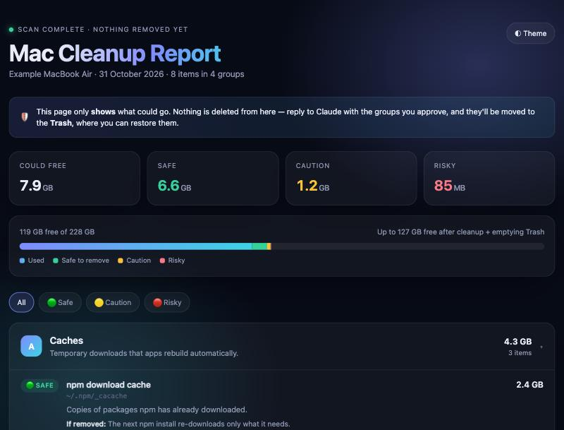

<div align="center">

# 🧹 mac-cleanup

**A safe, approval-first Mac cleanup skill for Claude.**

Finds the gigabytes you don't need, explains every item in plain English, rates how risky it is to remove, and only touches what you approve. Everything goes to the Trash, never deleted outright.




</div>

---

## ✨ What it does

| | |
|---|---|
| 🔍 **Scans, read-only** | Caches, build folders, idle virtualenvs, unused apps, leftovers from uninstalled apps, orphaned background jobs, and VS Code extensions. |
| 🚦 **Rates every item** | 🟢 **Safe** — rebuilt automatically · 🟡 **Caution** — a one-time re-download or rebuild · 🔴 **Risky** — could hold your data, always asked about individually. |
| 💬 **Explains everything** | What it is, its size, why you don't need it, what happens if it's removed, and how to undo it. |
| 🎨 **Themed report** | A dark/light HTML report with totals, a disk bar and risk filters opens in your browser. |
| 🛡️ **Asks before removing** | Nothing moves until you pick groups. A final ⚠️ confirmation lists exactly what's going. |
| ♻️ **Trash, not `rm`** | Every item can be restored until you empty the Trash yourself. |

It never touches your Documents, Desktop, Pictures, Music, project source code, SSH keys or Keychains, and never asks for your password. For system-level items it hands you a single command to paste.

## 📦 Install

**Option A — Claude Code plugin**

```
/plugin marketplace add Vijayrajdev/mac-cleanup
/plugin install mac-cleanup@mac-cleanup
```

**Option B — copy the skill**

```bash
git clone https://github.com/Vijayrajdev/mac-cleanup.git
mkdir -p ~/.claude/skills && cp -R mac-cleanup/skills/mac-cleanup ~/.claude/skills/
```

**Option C — claude.ai**

Zip the `skills/mac-cleanup` folder and upload it under **Settings → Capabilities → Skills**.

## 🚀 Use it

In Claude Code, type:

```
/mac-cleanup
```

or just say *"clean my Mac"*. Claude will scan, open the report, and ask which groups to remove.

### Run it every month

In the Claude desktop app, open **Scheduled → New task**, set it to the 1st of every month, and use the prompt:

> Run my monthly Mac cleanup using the mac-cleanup skill. Ask before removing anything.

## 🗂️ What's inside

```
skills/mac-cleanup/
├── SKILL.md                     # the step-by-step cleanup procedure Claude follows
└── scripts/
    ├── render_report.py         # turns findings JSON into the HTML report
    └── report-template.html     # the themed report (dark + light, responsive)
examples/
├── sample-findings.json         # example input
└── sample-report.html           # example output — open it in a browser
```

Try the report without scanning anything:

```bash
python3 skills/mac-cleanup/scripts/render_report.py examples/sample-findings.json --open
```

## ⚠️ Disclaimer

This skill only moves files to the Trash after you approve them, but you are responsible for what you approve. Read each item's warning, especially 🔴 Risky ones, and check the Trash before emptying it.

## 👤 Author

**Vijay Raj C K**

- 🌐 Website: [vijayraj.vercel.app](https://vijayraj.vercel.app/)
- 💻 GitHub: [@Vijayrajdev](https://github.com/Vijayrajdev)

If this saved you some space, a ⭐ on the repo is appreciated.

## 📄 License

[MIT](LICENSE) © Vijay Raj C K
